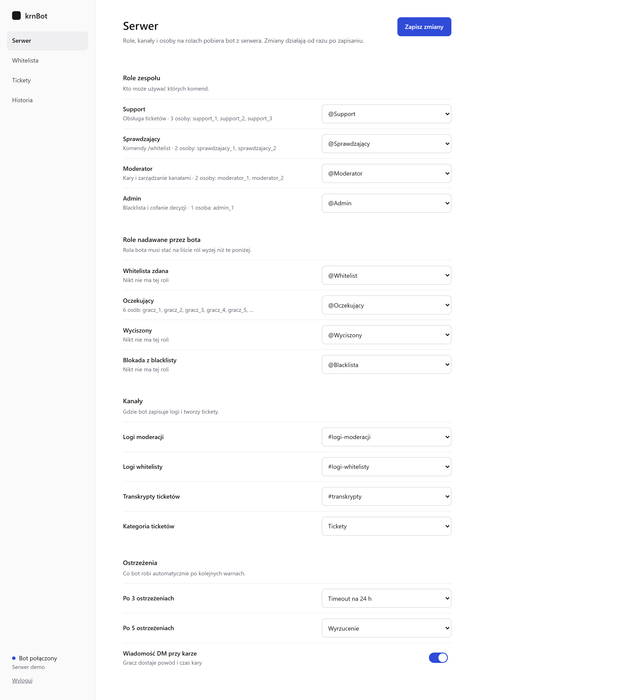
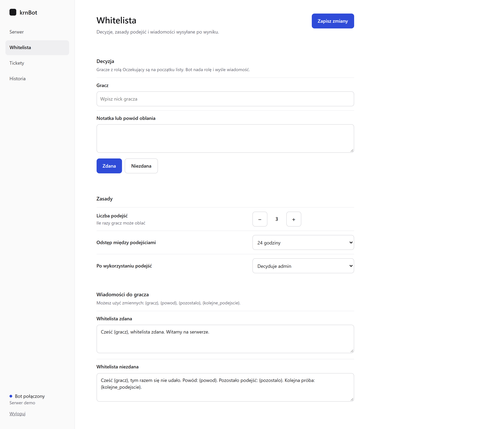
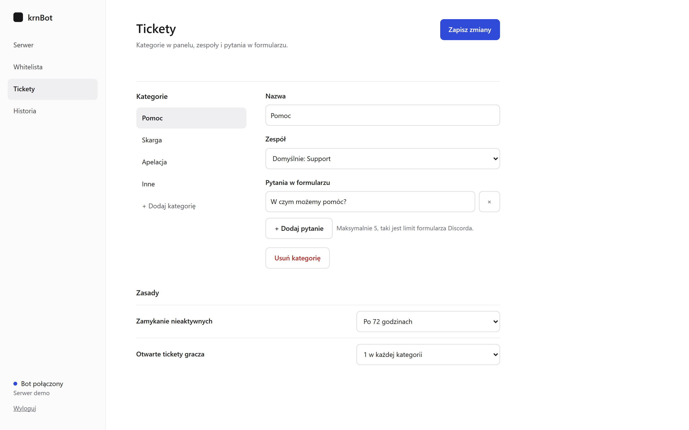
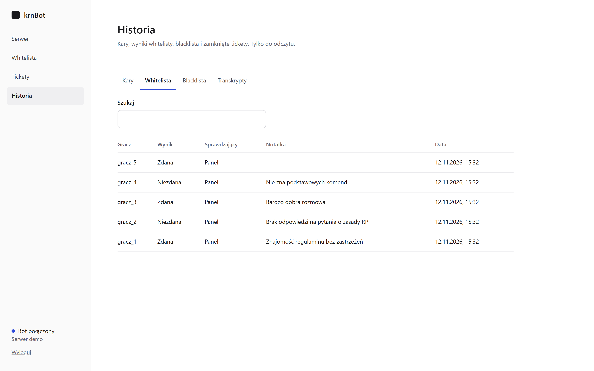

<h1 align="center">krnBot</h1>

  Bot Discord do prowadzenia serwera społeczności: tickety, moderacja, whitelista i blacklista, 
  z własnym panelem www do konfiguracji i podglądu historii. 
  Projekt i wykonanie: <b>krngg.dev</b>

  

---

## O projekcie

krnBot przejmuje codzienną pracę administracji serwera Discord. Zgłoszenia trafiają do ticketów, kary są nakładane jedną komendą i zapisywane w historii, a nowi gracze przechodzą przez whitelistę z limitem podejść. Całą konfigurację ustawia się w przeglądarce, bez edytowania plików i bez restartu bota.

> Zrzuty ekranu pokazują tryb demonstracyjny ze zmyślonymi danymi. Kod źródłowy nie jest publiczny.

## Panel www

Panel działa obok bota i odświeża się na żywo, kiedy na serwerze coś się zmieni.

- **Serwer:** przypisanie ról zespołu (Support, Sprawdzający, Moderator, Admin) i ról nadawanych przez bota, z podglądem, kto je ma
- **Whitelista:** decyzje „zdana / niezdana”, limit podejść, odstęp między nimi i treść wiadomości do gracza
- **Tickety:** kategorie, zespoły odpowiedzialne za każdą z nich i pytania w formularzu
- **Historia:** kary, wyniki whitelisty, blacklista i transkrypty zamkniętych ticketów, z wyszukiwarką

  
  

  

## Funkcje na Discordzie

**Tickety**
- Panel z przyciskami i formularzem dla każdej kategorii
- Przejmowanie ticketu, dodawanie i usuwanie osób
- Automatyczne zamykanie nieaktywnych zgłoszeń
- Transkrypt rozmowy zapisany po zamknięciu

**Moderacja**
- `/ban`, `/kick`, `/timeout`, `/mute` z czasem i powodem
- Ostrzeżenia `/warn` z numerami spraw i możliwością cofnięcia
- `/clear`, `/slowmode`, `/lock` i `/unlock` do porządku na kanałach
- Pełna historia spraw każdego gracza

**Whitelista i blacklista**
- Oznaczanie wyniku komendą albo w panelu, a bot sam nadaje role i wysyła wiadomość
- Historia podejść i cofanie decyzji
- Blacklista czasowa albo stała, z automatyczną rolą blokady

**Informacje**
- `/userinfo`, `/serverinfo`, `/ping`, `/pomoc`

## Technologie

| Część | Stos |
| --- | --- |
| Bot | Java 21, JDA (komendy slash, przyciski, formularze) |
| Panel www | Javalin, HTML/CSS/JS, aktualizacje na żywo przez SSE |
| Dane | SQLite |
| Bezpieczeństwo | Logowanie tokenem panelu, komunikacja bota i panelu podpisana kluczem API |

---

<h3 align="center">Potrzebujesz podobnego bota dla swojej społeczności?</h3>

  Projektuję i buduję boty Discord oraz aplikacje mobilne i webowe dopasowane do Twoich potrzeb. 
  Napisz, czego potrzebujesz, a odezwę się z propozycją.

  <a href="https://krngg.dev"><b>krngg.dev · kontakt →</b></a>

© krngg.dev. Wszelkie prawa zastrzeżone.

